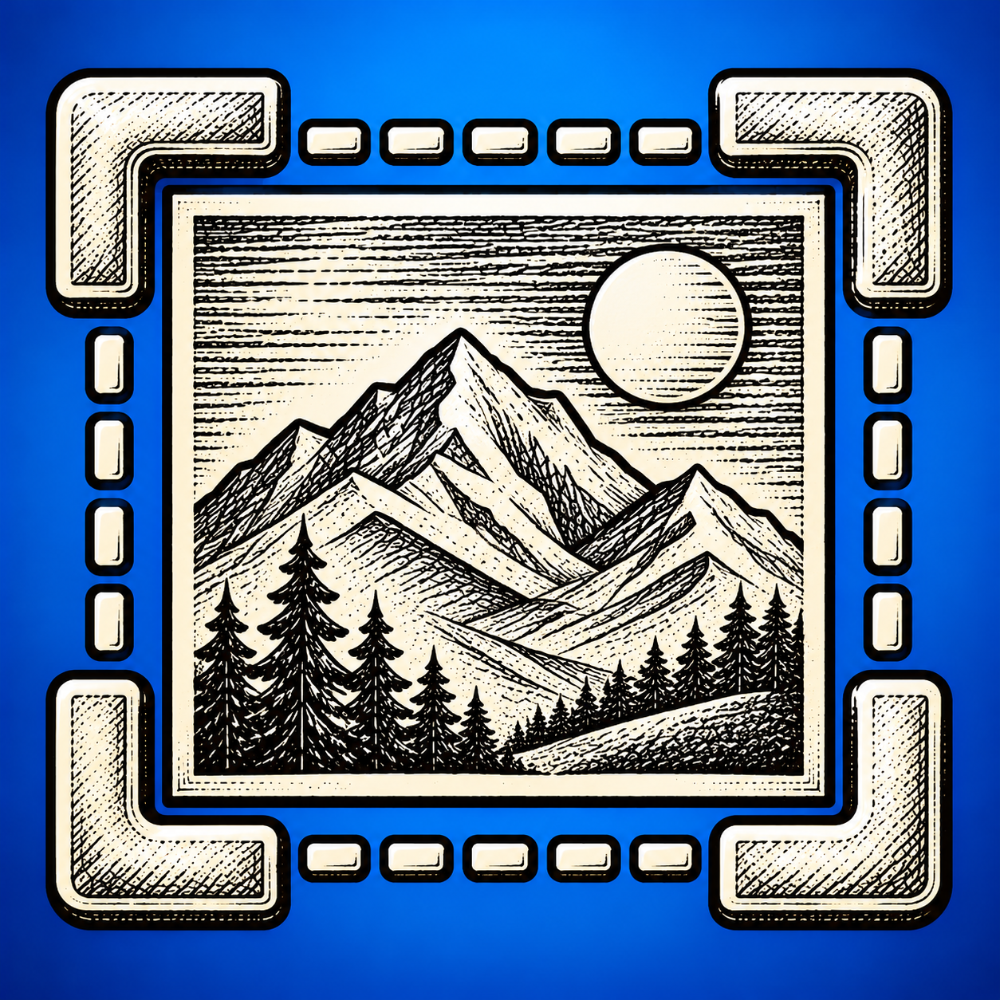
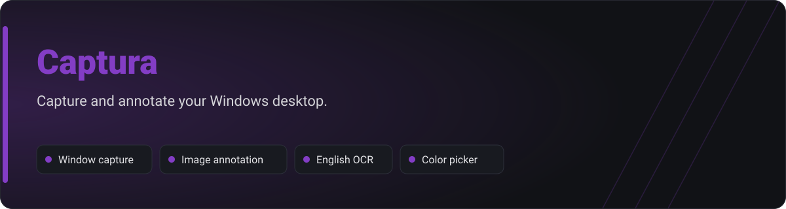
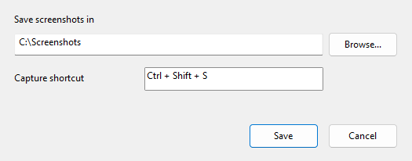
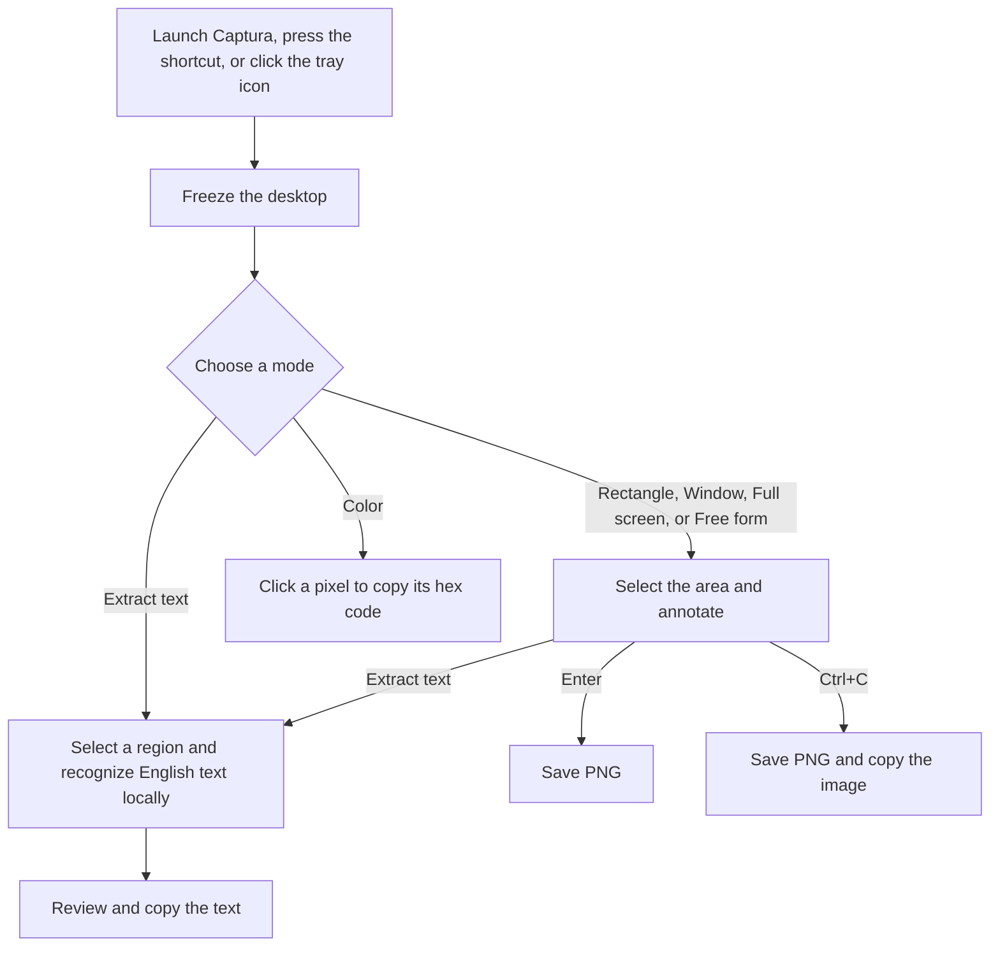

<div align="center">



# Captura

Take a Windows screenshot, mark it up, and save or copy it from the capture overlay.


<br /><br />



<br /><br />

[Features](#features) • [Screenshots](#screenshots) • [How it works](#how-it-works) • [Installation](#installation) • [Usage](#usage) • [Configuration](#configuration) • [Troubleshooting](#troubleshooting)

</div>

## About

Captura freezes the desktop when you start a capture, so you can select and annotate what was on screen at that moment. Its native Win32 overlay handles selection and editing. Rust writes the PNG and loads the bundled Tesseract engine when you request English text recognition. Recognition runs locally.

## Features

- **Select a capture area.** Drag a rectangle, trace a free-form outline, click a window, or choose an entire monitor.
- **Annotate in place.** Draw with a pen or highlighter, add arrows, shapes, text, or numbered markers, and pixelate part of the image.
- **Save and copy.** Save a timestamped PNG to your screenshot folder. The copy command also saves the PNG, so you can paste it immediately and keep the file.
- **Extract English text.** Drag over text in **Extract text** mode, then use **Copy text** in the results dialog. You can also run recognition from the annotation toolbar.
- **Sample a color.** In **Color** mode, hover to read the RGB values and click to copy the hexadecimal color code.

## Screenshots

<p align="center">
  
  <br />
  <em>The Settings dialog shows an example save folder and the default capture shortcut.</em>
</p>

## How it works



## Installation

On 64-bit Windows, download the installer named `Captura_<version>_x64-setup.exe`, run it, and launch Captura. The installer includes the English OCR model and its runtime libraries. [GitHub Releases](https://github.com/projectGloria/Captura/releases)

### Build from source

Use an x64 Windows machine with the Rust MSVC toolchain, Visual Studio C++ build tools (including the x64 redistributable files), and a Windows SDK. From the repository root, run these PowerShell commands to build Captura with OCR support and start it.

```powershell
.\scripts\package.ps1 -StageOnly
.\target\release\Captura.exe
```

The staging script downloads and verifies the OCR dependencies. For a capture-only build, run `cargo build --locked --release` and launch the same executable. OCR needs the `ocr` directory beside it.

## Usage

1. Launch Captura to start the first capture. For another capture, press **Ctrl+Shift+S** or click the Captura notification-area icon.
2. Choose a mode from the top toolbar. For a rectangular screenshot, drag from one corner of the area to the opposite corner.
3. Choose an annotation tool. For example, select **Arrow** and drag toward a detail, or click with **Numbered marker** to label a sequence.
4. Press **Enter** to save the PNG or **Ctrl+C** to save and copy it. Press **Esc** to discard the capture.

| While editing | Shortcut |
| --- | --- |
| Undo | Ctrl+Z |
| Redo | Ctrl+Y |
| Save PNG | Enter or Ctrl+S |
| Save PNG and copy the image | Ctrl+C |

## Configuration

Right-click the notification-area icon and choose **Settings…**, or click the gear in the capture toolbar. Choose **Save** to apply your changes.

| Setting | Default | How to change it |
| --- | --- | --- |
| Save screenshots in | Your Windows Pictures folder | Browse to a folder or enter an absolute path. |
| Capture shortcut | Ctrl+Shift+S | Focus the shortcut field and press the desired combination. |

Captura stores these preferences in `%APPDATA%\com.gloria.captura\settings.ini`.

## Troubleshooting

- **The capture shortcut is unavailable.** Click the tray icon to capture immediately. To choose a free combination, right-click the icon and open **Settings…**.
- **The PNG saved, but the clipboard was busy.** Use **Copy** again in the overlay. The saved PNG is already in your screenshot folder.
- **Saving failed.** Choose another folder when prompted and select a location you can write to.
- **Text extraction failed after a source build.** Run the staging command under [Build from source](#build-from-source). Keep the entire `ocr` folder beside `Captura.exe`, including `eng.traineddata` and the DLLs.
